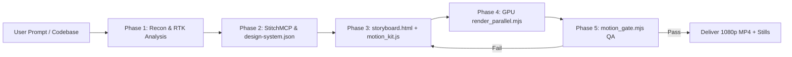

# Codebase Motion Graphics (`codebase-motion-graphics`)

[](LICENSE)
[]()
[]()
[]()

Turn any codebase into a **real motion graphic**: components move, data flows, and architectures explain themselves every second of the video, rendered in a bespoke visual language derived directly from the project's identity.

> **Zero static slideshow holds.** No frame duplication tricks (`-loop 1`, `ffconcat duration`). Every single frame is rendered and verified by an automated luma-delta motion gate.

---

## Key Capabilities

1. **Deterministic Function of Time (`seekTo(t)`)**
   - The entire canvas is a pure function of $t$ (seconds). Redraws are state-free and reproducible using the included `motion_kit.js` (seeded `rng()`, `noise2`, `bez`, easing curves).
2. **Discrete GPU Parallel Acceleration**
   - Launches headless Chromium with ANGLE Direct3D11 hardware acceleration (`--force_high_performance_gpu`, `--enable-accelerated-2d-canvas`).
   - Streams JPEG frames directly from the GPU canvas inside the page over exposed Node bindings to `ffmpeg` with hardware encoders (`h264_nvenc`, `h264_qsv`, `h264_amf`).
   - Renders **600 frames (20s @ 1080p30) in ~24–28 seconds** on an NVIDIA Quadro P3200.
3. **StitchMCP Integration & Asset Generation**
   - Interacts with `StitchMCP` to extract verified design systems (`designMd`, color tokens, font stacks).
   - Downloads real UI mockups or synthesizes custom screens via `generate_screen_from_text` to composite directly into the motion canvas as textures.
4. **Automated Motion Gate Verification (`motion_gate.mjs`)**
   - Rigorously checks that no static stretch exceeds **1.5 seconds** and that less than **10%** of samples are frozen.
5. **Per-Project Distinct Design Systems**
   - Never reuses templates. Every project receives its own `design-system.json` reflecting its domain (e.g. Algorithmic Neobrutalism, Bureaucratic Slate, Living Newspaper Broadsheet, Tactical Cybernetic Radar).

---

## Architecture Pipeline



---

## Installation & Setup

### Option A: Install as an Agent Skill
To add this skill to your agent environment:
```bash
# Via skills.sh package manager
npx skills add AhmedNasser-bug/codebase-motion-graphics -g -y

# Or clone directly into your agent skills directory
git clone https://github.com/AhmedNasser-bug/codebase-motion-graphics.git ~/.agents/skills/codebase-motion-graphics
```

### Option B: Standalone CLI Usage
Clone the repository and install dependencies:
```bash
git clone https://github.com/AhmedNasser-bug/codebase-motion-graphics.git
cd codebase-motion-graphics
npm install
```

Verify your environment (Node.js, Playwright, FFmpeg with NVENC/QSV support):
```bash
npm run check-env
```

---

## Quickstart: Creating a Motion Graphic

### 1. Build your Storyboard
Create `storyboard.html` and copy `scripts/templates/motion_kit.js` beside it:
```html
<canvas id="c" width="1920" height="1080"></canvas>
<script src="motion_kit.js"></script>
<script>
  const c = document.getElementById('c').getContext('2d');
  const vis = (t, a, b, f = 0.35) => seg(t, a, a + f) * (1 - seg(t, b - f, b));

  window.seekTo = function(t) {
    // 1. Draw always-on background motion
    // 2. Draw scene elements using vis(t, start, end)
  };

  window.seekTo(0);
</script>
```

### 2. Render with GPU Acceleration
```bash
node scripts/render_parallel.mjs storyboard.html output.mp4 20 30 1920 1080 3
```
- Argument 1: Path to `storyboard.html`
- Argument 2: Output MP4 path
- Argument 3: Duration in seconds (e.g. `20`)
- Argument 4: FPS (e.g. `30`)
- Argument 5: Width (`1920`)
- Argument 6: Height (`1080`)
- Argument 7: Number of parallel browser workers (`3`)

### 3. Verify with the Motion Gate
```bash
npm run gate output.mp4
```
Outputs pass/fail metrics:
```json
{
  "file": "output.mp4",
  "samples": 80,
  "avgDiff": 7.53,
  "frozenPct": 0.0,
  "longestStaticSec": 0.0
}
MOTION GATE PASSED
```

---

## Benchmarked Projects

This engine has been battle-tested across 6 diverse production codebases:

| Project | Domain & Archetype | Render Time (NVENC) | Motion Gate |
|---|---|---|---|
| **Code Analysis** | Cybernetic Asymptotic Compiler (Obsidian & Cyan) | **25.5s** | **PASSED** (0.50s max static) |
| **livestar-portfolio** | The Living Newspaper Broadsheet (Astro v5 & GSAP) | **25.0s** | **PASSED** (0.00s max static) |
| **AIProject Part 2** | Tactical Heuristic Radar & 8-Queens / Sudoku CSP | **24.3s** | **PASSED** (0.25s max static) |
| **Algorithm-Analysis**| Algorithmic Neobrutalism (C# & Charting) | **28.2s** | **PASSED** (0.25s max static) |
| **DVLD System** | Bureaucratic Sovereign Slate (3-Tier Architecture) | **30.7s** | **PASSED** (0.25s max static) |
| **finals-qb** | Arcade Matrix Mastery (Next.js Exam Platform) | **27.5s** | **PASSED** (0.25s max static) |

---

## License

MIT License. Designed and maintained by Ahmed Nasser.
