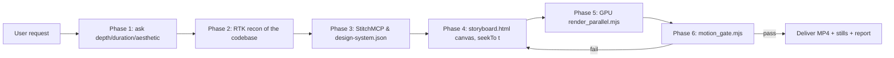

# Codebase Motion Graphics (`codebase-motion-graphics`)

Turn a codebase into a **real motion graphic**: things move, flow, draw themselves and react, every second of the video, in a visual language that belongs to *that* project.

## Motion Law (non-negotiable, learned from a failed slideshow render)
1. **No static holds.** No stretch longer than **1.5 s** may be visually frozen. Every scene needs an always-on layer (flow packets, drifting grid, generative background, camera drift, looping loader) in addition to its entrance animations.
2. **A new beat every 2–3 s** (reveal, highlight, camera move, counter tick).
3. **Never use hold-frame / frame-duplication shortcuts** (`ffconcat duration`, `-loop 1` etc). Render **every frame**. Speed comes from parallel workers, not from skipping frames.
4. **Animation = pure function of `t`.** One `window.seekTo(t)` redraws the whole frame from `t` alone (no timers, no `Math.random()`; use the seeded `rng()` in `motion_kit.js`). This makes rendering deterministic and parallelisable.
5. **Verification gate before delivery:** `node scripts/motion_gate.mjs video.mp4`. It fails if the longest static stretch is above 1.5 s or more than 10% of samples are frozen. Fix and re-render until it passes.
6. **Long videos are many short beats, not few long slides.** For 5+ minute requests, a 10-min video needs ~200+ beats. If you cannot afford that, propose a shorter cut instead of stretching slides.

## Asset Generation & StitchMCP Integration

Visual authenticity requires embedding real UI mockups, design tokens, and synthesized domain assets into the motion canvas:

1. **StitchMCP Integration:**
   - **Discover & Extract Design Tokens:** Call `list_projects` or `get_project` to inspect `designTheme` and `designMd`. Extract verified color palettes, typography scales, border radii, and elevation models directly into `design-system.json`.
   - **Screen & Asset Acquisition:** Call `list_screens` and `download_file` using the screen's `screenshot.name` or `html_code.name` to obtain base64-encoded UI mockups.
   - **On-Demand Screen Synthesis:** If a project lacks a UI mockup (e.g. CLI, backend, or AI service), call `generate_screen_from_text` on StitchMCP to create a high-fidelity dashboard screen, download its thumbnail/screenshot, and embed it as a primary visual anchor.
   - **In-Canvas Compositing:** Load downloaded Stitch UI assets via `const img = new Image(); img.src = "data:image/png;base64,...";` or local files, rendering them dynamically inside device viewports with perspective, drop shadows, and scanlines.

2. **Domain Asset & Icon Generation:**
   - Use the `image-generator` subagent or generative SVG/Canvas shaders to synthesize project badges, circuit schematics, AST trees, neural network layer weights, or brand crests.
   - Store synthesized assets in `assets/` relative to `storyboard.html`.

## One design system per project (never reuse)
Before storyboarding, derive a design system from the target project and save `design-system.json` beside the storyboard.
1. **Read the project's identity:** `DESIGN.md`, README, `globals.css`/theme tokens, logos, domain vocabulary (algorithms lab != licensing dept != arcade quiz app != ML code analysis).
2. **`/design-consultation`:** aesthetic direction, palette, type pairing, motion character, layout grid.
3. **`/canvas-design`:** a one-line visual philosophy and the key composition rules.
4. **`/algorithmic-art`:** a seeded generative layer as the always-on background (sort snapshots, flow field, spirograph guilloche, glyph rain, AST graphs).
5. **`/poster-design`:** title card and outro composition (hierarchy, scale contrast).
6. **`/modern-web-guidance` + `/web-artifacts-builder`:** use modern CSS/JS where DOM is better than canvas; use the Vite + React + shadcn artifact route only if the storyboard needs complex state.
Tokens that must be unique per project: palette, display + data fonts, card/shape language, motion character, background generator.

## Pipeline


### Phase 1: Interview (mandatory `ask_question`)
Always ask: (a) **depth** (high-level topology / data flow & API lifecycle / deep implementation & security / onboarding tour), (b) **duration**, (c) **aesthetic**: default "derive from project", (d) **motion intensity**. Do not render before answers.

### Phase 2: Recon (RTK: never read whole big files)
Entry points and package manifest, layers and folders, data/persistence, security rules, shared libs. Capture only **verified** names (files, folders, tables). Do not invent features or counts; count from the directory listing.

### Phase 3: StitchMCP & Asset Preparation
- Query StitchMCP for existing design systems or generate a new UI screen for the project.
- Download screenshots and SVG icons.
- Write `design-system.json` containing the colors, typography, layout rules, and asset references.

### Phase 4: Storyboard
- Single `storyboard.html` with a 1920x1080 `<canvas>` and `<script src="motion_kit.js">` (copy `scripts/templates/motion_kit.js` next to it).
- Helpers: `seg(t,a,b)`, `E.out/inOut/back/elastic/expo`, `rng(seed)`, `noise2`, `bez`, `rr`, `typed`.
- Structure: persistent background layer + 4–6 scenes with `vis(t,a,b)` fades. 20 s ≈ 5 scenes: title (3 s), the core mechanism (5 s), architecture/data flow (5 s), key detail (4 s), outro (1–2 s).
- Fonts: use installed system fonts only (renders offline). Bahnschrift/Georgia/Consolas/Impact/Segoe UI are present on Windows.

### Phase 5: GPU-Accelerated Parallel Render
```bash
node scripts/render_parallel.mjs storyboard.html out.mp4 <seconds> 30 1920 1080 3
```
- **GPU Canvas & Rasterization:** `render_parallel.mjs` launches Chromium with `--force_high_performance_gpu`, `--use-gl=angle`, `--use-angle=d3d11`, `--enable-gpu-rasterization`, `--enable-oop-rasterization`, and `--enable-accelerated-2d-canvas`.
- **In-Page GPU Frame Streaming:** When the storyboard exposes `<canvas id="c">`, each worker context encodes JPEG frames directly from the GPU canvas via `canvas.toDataURL("image/jpeg", 0.92)` inside the page and streams them over an exposed Node binding, eliminating full-window DevTools screenshot IPC overhead.
- **Hardware Video Encoding:** Automatically probes and selects `h264_nvenc` (NVIDIA NVENC) -> `h264_qsv` (Intel QuickSync) -> `h264_amf` (AMD AMF) -> `libx264` fallback. Default `workers=3`.
- **Speed:** 600 frames (20 s @ 1080p30) renders in ~27-30 s on NVENC.

### Phase 6: Gate and deliver
`node scripts/motion_gate.mjs out.mp4` must print `MOTION GATE PASSED`. Extract 4–5 stills with ffmpeg and check them visually. Deliver the MP4 path, duration/size, the design-system summary, and the stills in a report artifact.

## Process hygiene
Kill background renders when done (`manage_task list`); `render_parallel` closes its own browsers. Delete temp dirs. Do not commit videos to the project repo unless asked.
