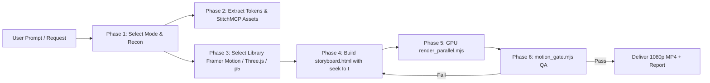

# Codebase & Product Motion Graphics (`codebase-motion-graphics`)

Turn codebases, software products, pitches, and web platforms into **real motion graphics**: components move, 3D wireframe tunnels drift, service meshes rotate, and kinetic typography grabs attention every second of the video.

> **The Non-Negotiable Motion Law:** No static holds. No stretch longer than **1.5 seconds** may be visually frozen. Every scene requires an always-on motion layer (3D Three.js tunnel, p5 generative flow field, Framer Motion spring physics, floating particles). Render **every frame** with parallel GPU workers.

---

## High-Level Motion Library Hierarchy

> [!IMPORTANT]
> **Strict Mandate:** Using manual bezier curves or raw CSS transforms is a **last resort**. Always utilize high-level declarative motion libraries:
> 1. **Framer Motion (`framer-motion` / Motion One):** For UI spring physics, layout morphing, staggered entrances, and declarative gesture states.
> 2. **Three.js (`three`):** For 3D spatial meshes, geometric wireframe tunnels (Hive Germany style), floating holographic badge perspective, and dynamic lighting.
> 3. **p5.js + `/algorithmic-art`:** For seeded mathematical flow fields, generative noise particles, and algorithmic manifolds.
> 4. **GSAP (`gsap`):** For deterministic multi-track timeline sequencing and complex SVG morphing.
> 5. **StitchMCP:** For live design token extraction (`designMd`), color themes, and on-demand UI screen generation.

---

## The 7 Production Categories / Sub-Modes

When initializing a motion project, identify or ask for the target sub-category:

### 1. `mode: pitch` — Pitching Businesses & Products
* **Objective:** Investor pitch decks, startup launch presentations, ROI/traction showcases, and value proposition narratives.
* **Aesthetic:** High-contrast executive elegance, clean metric callouts, market size comparisons, and revenue trajectory graphs.
* **Key Visuals:** Dynamic counter tickers, capital efficiency meters, client logo cascades, and animated problem-to-solution matrices.

### 2. `mode: codebase` — Understanding Codebases
* **Objective:** Deep technical onboarding, architectural layer tours, and security/data flow explainers.
* **Aesthetic:** Terminal ergonomics, cybernetic blueprints, syntax-highlighted code streams, and system topology maps.
* **Key Visuals:** AST tree branching, RPC service call packets, database schema joins, and API lifecycle pipelines.

### 3. `mode: web-bg` — Web Background Video Assets (Portfolio & Hero Sections)
* **Objective:** Seamless, ambient, looping background videos designed to sit behind website hero text (`<video autoplay loop muted playsinline>`).
* **Inspirations:**
  * **Hive Germany Showcase:** Deep obsidian tunnel of tumbling 3D wireframe cubes with coral/peach outlines, perspective vortex, and geometric depth.
  * **Holographic 3D Cards / Studio:** Suspended badges with holographic iridescent foil reflections, soft ambient occlusion, and subtle inertia drift.
* **Key Constraint:** Must have zero distracting abrupt jumps, low contrast in text zones, and perfect looping continuity between $t = 0$ and $t = \text{end}$.

### 4. `mode: ad` — Making Stunning Commercial Ads
* **Objective:** High-energy social media ads, launch teasers, and billboard videos that capture attention within 0.5 seconds.
* **Aesthetic:** Maximalist kinetic typography, massive text scale contrasts (Hive-style display type), flash frames, chromatic aberration, and punchy transitions.
* **Key Visuals:** Bold one-word impact cuts, rhythmic camera zooms, high-voltage accent strikes, and compelling CTA finales.

### 5. `mode: software-ad` — Software, Web App & Mobile App Ads
* **Objective:** High-converting product commercials, SaaS promos, and cross-platform (Web + iOS + Android) showcases.
* **Aesthetic:** Realistic 3D device mockups (MacBook, iPhone, clean browser viewport) floating with gentle perspective tilt.
* **Key Visuals:** Screencast compositing, cursor clicks, smooth feature zoom-ins, toggle interactions, and dark/light mode morphing.

### 6. `mode: tutorial` — Tutorial Motion Graphics Videos (Product & Educational Walkthroughs)
* **Objective:** Step-by-step user onboarding, educational walkthroughs, how-to guides, and feature workflows.
* **Aesthetic:** Crystal-clear pedagogical clarity, numbered step badges ("Step 1", "Step 2", "Step 3"), spotlight callout masks, and smooth zooming.
* **Key Visuals:** Animated mouse cursor with click ripple waves, UI spotlight focus masks, progressive breadcrumb timeline, tooltips with spring bounce, and verified success badges.

### 7. `mode: general` — General Procedural Motion Graphics
* **Objective:** Mathematical visualizations, abstract branding identities, and procedural motion experiments.

---

## Production Pipeline



### Phase 1: Interview & Mode Selection
Confirm the production mode:
* `1` Pitching businesses/products
* `2` Understanding codebases
* `3` Web background video asset
* `4` Stunning commercial ad
* `5` Software / app demo
* `6` Tutorial motion graphics (step-by-step educational guide)
* `7` General

### Phase 2: Design System & Assets
* Query `StitchMCP` to extract typography, colors, and generate missing UI screens.
* Prepare `design-system.json` detailing color tokens, fonts, and motion character.

### Phase 3: Storyboard Authoring (`storyboard.html`)
* Use standard templates from `scripts/templates/`:
  * `tutorial_storyboard_template.html` (Mode 6: Step-by-step tutorial with animated cursor, UI spotlight, and progress bar)
  * `framer_motion_template.html` (Framer Motion spring physics + DOM components)
  * `hive_3d_tunnel_bg_template.html` (Mode 3: Three.js wireframe geometric tunnel)
  * `holographic_cards_template.html` (3D floating perspective cards)
  * `threejs_storyboard_template.html` (3D cluster topologies)
  * `p5_storyboard_template.html` (p5.js generative flow fields)
* Every storyboard exposes `window.seekTo = function(t)` where $t$ is the elapsed seconds.

### Phase 4: Discrete GPU Parallel Render
```bash
node scripts/render_parallel.mjs storyboard.html output.mp4 20 30 1920 1080 3
```
* Employs Chromium ANGLE Direct3D11 on NVIDIA discrete GPU.
* In-page canvas JPEG streaming piped directly to `ffmpeg -c:v h264_nvenc`.
* Renders 600 frames (20s @ 1080p30) in **~24–28s**.

### Phase 5: Motion Gate Verification (`motion_gate.mjs`)
```bash
node scripts/motion_gate.mjs output.mp4
```
* Must pass:
  1. Maximum static stretch $\le 1.5\text{s}$.
  2. Frozen frame percentage $< 10\%$.

---

## Process Hygiene
* Kill child processes upon completion.
* Proactively audit tasks with `manage_task list`.
* Clean temporary segment files.
