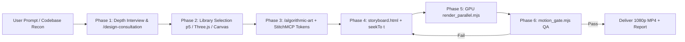

# Codebase Motion Graphics (`codebase-motion-graphics`)

Turn a codebase into a **real motion graphic**: components move, service meshes rotate in 3D, generative noise fields react, and architectures explain themselves every second of the video, rendered in a bespoke visual language derived directly from the project's identity.

> **The Non-Negotiable Motion Law:** No static holds. No stretch longer than **1.5 seconds** may be visually frozen. Every scene requires an always-on motion layer (generative p5 flow field, orbiting Three.js mesh, continuous vector packets, drifting grid). Render **every frame** with parallel GPU workers.

---

## Motion Graphics Libraries & Specialized Skill Orchestration

The skill integrates industry-standard motion graphics engines, cross-pollinating with existing visual skills:

### 1. Generative Backgrounds & Particle Physics: `p5.js` + `/algorithmic-art`
* **Skill Integration:** Involves `/algorithmic-art` to establish an algorithmic philosophy (e.g. "Quantum Harmonics", "Emergent Stillness", "Fluid Convergence") before coding.
* **p5.js Canvas Pipeline:** Uses p5 instance mode (`new p5(sketch)`) with `p.noLoop()` and a deterministic `p.drawFrameAt(t)`.
* **Techniques:** Seeded vector flow fields (`p.noise()`), particle swarm simulations, organic density wavemaps, recursive tree branching, and spirograph guilloches.
* **Template Reference:** `scripts/templates/p5_storyboard_template.html`.

### 2. 3D Spatial Topologies & Service Meshes: `Three.js` + `/canvas-design`
* **Skill Integration:** Utilizes `/canvas-design` principles for visual balance, focal points, camera projection, and lighting hierarchy.
* **Three.js WebGL Pipeline:** Leverages `THREE.WebGLRenderer({ alpha: true, antialias: true })` driven by direct GPU rasterization.
* **Techniques:** Orbiting 3D microservice nodes, dynamic service mesh line segments, glowing particle halos, rotating volumetric database cylinders, and camera flight paths through architectural layers.
* **Template Reference:** `scripts/templates/threejs_storyboard_template.html`.

### 3. Kinetic Typographic & Card Transitions: `GSAP` + `/frontend-design`
* **Skill Integration:** Pulls from `/frontend-design` for deliberate, non-templated typography pairings, color contrast, and micro-interactions.
* **GSAP Animation Pipeline:** Employs GSAP `CustomEase` and deterministic seekable timelines (`tl.seek(t)`) or pure math functions in `motion_kit.js`.
* **Techniques:** Spring overshoots (`E.back`), stagger animations across file tree cards, kinetic text reveals, and metric counters.

### 4. Bespoke UI Mockups & Design Tokens: `StitchMCP`
* **Token Extraction:** Calls `list_projects` / `get_project` to harvest `designTheme` and `designMd` tokens (colors, typography, elevation).
* **Screen Generation:** Calls `generate_screen_from_text` to generate high-fidelity UI dashboards for CLI or backend projects, downloading them via `download_file` to composite directly into the WebGL / 2D canvas.

### 5. Layout & Composition Hierarchy: `/poster-design`
* **Skill Integration:** Guides scene titles, hero typography, negative space, and outro card seals for agency-grade visual impact.

---

## Production Pipeline



### Phase 1: Interview & Recon
1. Ask depth (topology / data flow / deep implementation), duration (default 20s), aesthetic, and preferred engine (p5.js generative, Three.js 3D spatial, or Canvas 2D terminal).
2. RTK reconnaissance: extract actual filenames, directory counts, database schemas, and architectural boundaries.

### Phase 2: Engine Selection & Design System
Select the appropriate rendering stack based on codebase domain:
* **Microservices / Cloud / Distributed Systems:** `Three.js` (3D cluster spheres, orbiting mesh, directional lighting).
* **Algorithms / Compilers / Data Science:** `p5.js` + `/algorithmic-art` (flow fields, AST tree growth, mathematical manifolds).
* **SaaS / Web Applications / E-Commerce:** `GSAP` + `Canvas 2D` + `StitchMCP` (broadsheet layouts, device frames, UI screen mockups).
Save the resulting configuration in `design-system.json`.

### Phase 3: Storyboard Implementation (`storyboard.html`)
* Every storyboard must define `window.seekTo = function(t)` where $t$ is the elapsed time in seconds.
* Composite WebGL / p5 canvases with a 2D HUD canvas onto the master `<canvas id="c" width="1920" height="1080">`.
* Ensure an always-on layer guarantees movement every second of the video.

### Phase 4: GPU-Accelerated Parallel Render
```bash
node scripts/render_parallel.mjs storyboard.html output.mp4 20 30 1920 1080 3
```
* **Discrete GPU Acceleration:** Launches Chromium with `--force_high_performance_gpu`, ANGLE Direct3D11, `--enable-accelerated-2d-canvas`, `--allow-file-access-from-files`, and `--disable-web-security`.
* **In-Page GPU Frame Streaming:** Avoids DevTools IPC overhead by encoding directly from the GPU canvas via `canvas.toDataURL("image/jpeg", 0.92)` and streaming to `ffmpeg` with hardware acceleration (`h264_nvenc` / `h264_qsv` / `h264_amf`).
* **Performance:** 600 frames (20s @ 1080p30) renders in **~24–28 seconds**.

### Phase 5: Automated Verification Gate (`motion_gate.mjs`)
```bash
node scripts/motion_gate.mjs output.mp4
```
* Rigorously samples frame luma deltas.
* Must satisfy:
  1. Longest static stretch $\le 1.5\text{s}$.
  2. Total frozen frame samples $< 10\%$.

---

## Process & Resource Hygiene
* Terminate child browser processes upon completion.
* Proactively audit running processes with `manage_task list`.
* Keep temporary segment directories clean.
