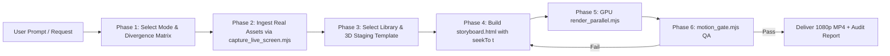

# Codebase & Product Motion Graphics (`codebase-motion-graphics`)

Turn codebases, software products, pitches, and web platforms into **real motion graphics**: components move, 3D wireframe tunnels drift, service meshes rotate, and kinetic typography grabs attention every second of the video.

> **The Non-Negotiable Motion Law:** No static holds. No stretch longer than **0.5 seconds** may be visually frozen. Every scene requires an always-on motion layer (3D Three.js tunnel, p5 generative flow field, Framer Motion spring physics, floating particles). Render **every frame** with parallel GPU workers.

---

## High-Level Motion Library Hierarchy

> [!IMPORTANT]
> **Strict Mandate:** Using manual bezier curves or raw CSS transforms is a **last resort**. Always utilize high-level declarative motion libraries:
> 1. **Framer Motion (`framer-motion` / Motion One):** For UI spring physics, layout morphing, staggered entrances, and declarative gesture states.
> 2. **Three.js (`three`):** For 3D spatial meshes, geometric wireframe tunnels (Hive Germany style), floating holographic badge perspective, and dynamic lighting.
> 3. **p5.js + `/algorithmic-art`:** For seeded mathematical flow fields, generative noise particles, and algorithmic manifolds.
> 4. **GSAP (`gsap`):** For deterministic multi-track timeline sequencing and complex SVG morphing.
> 5. **StitchMCP:** For live design token extraction (`designMd`), color themes, and on-demand UI screen generation.

---

## Strict Anti-Repetition Rules & Reality Mandate

Algorithmic motion generation must never suffer from template incest. Adhere strictly to the Anti-Cliché Rubric:

1. **Zero Faux-Browser Rectangles:**
   In **Mode 5 (Software Demo)**, never use flat 2D `ctx.fillRect` with three colored dots or crude SVG line art to fake an application frame. Mode 5 strictly mandates photorealistic 3D hardware staging (`macbook_3d_template.html` or `mobile_device_template.html`).
2. **Asset Authenticity (App Reality):**
   Mandatory ingestion of real application UI screenshots or screencasts using `capture_live_screen.mjs`. Never use synthetic fake wireframes, lorem ipsum filler, or placeholder mockups when live endpoints exist.
3. **PBR Skeuomorphic Depth:**
   3D hardware rigs must employ dual-layer PBR materials (`MeshPhysicalMaterial` with `clearcoat: 1.0`, `clearcoatRoughness: 0.04`, calibrated metalness/roughness, and dynamic GLSL sheen sweeps) and soft contact shadows.
4. **Anisotropic Filtering Mandate:**
   All screen textures rendered at oblique camera perspective angles must set `texture.anisotropy = 16` (or `renderer.capabilities.getMaxAnisotropy()`) to guarantee razor-sharp text and UI legibility.
5. **Continuous Micro-Motion Continuity:**
   Static holds $> 0.5\text{s}$ are strictly prohibited. Devices must feature continuous gyroscopic pitch oscillations, camera breathing drift, or cursor interactions.

---

## Authoritative 9-Dimensional Mode Divergence Matrix

Every production category must maintain an unmistakable, distinct architectural identity:

| Production Dimension | Mode 5: Software Demo (`mode: software-ad`) | Mode 2 / 6: Tutorial & Walkthrough (`mode: tutorial` / `codebase`) | Mode 4: Commercial Ad (`mode: ad`) |
|---|---|---|---|
| **1. Primary Visual Rig** | **Photorealistic 3D Device (MacBook Pro 16" / iPhone 16 Pro) in Studio Lighting** | **Clean 2D Desktop Viewport with Magnification Spotlight & Step Badges** | **Massive Kinetic Typography, Holographic Cards & Shockwave Bursts** |
| **2. Asset Authenticity** | **Real production screencasts, authentic workflows, real data (e.g., finals-qb.vercel.app)** | Real UI with pedagogical overlay tooltips, step highlights, and cursor trails | High-impact conceptual graphics, bold metrics ($+340\%$), and slogan type |
| **3. Framing & Viewport** | 3D floating perspective tilt ($25^\circ$), unibody bevels, screen gloss sheen | Orthographic front-facing container with dark rounded window chrome | Full-screen canvas dynamic layouts, split-screen diagonal grids |
| **4. Pacing & Cut Frequency**| Smooth, continuous 3-act choreography ($2.5\text{s} - 4.5\text{s}$ per workflow sequence) | Step-by-step instructional pacing ($3.0\text{s} - 5.0\text{s}$ per numbered step) | Hyper-kinetic rapid cuts ($0.3\text{s} - 0.8\text{s}$ per flash card/phrase) |
| **5. Camera Kinematics** | Macro unibody sweep $\to$ Isometric orbit $\to$ Screen push-in | Smooth 2.5x cursor zoom-in, pan along UI elements, reset | Hard rhythmic zooms, Dutch angle rotations, kinetic screen shakes |
| **6. Cursor & Interaction**| Tactile vector pointer with hover scale and hydrodynamic click waves | Spotlight focus circle ($r = 140\text{px}$), step badges, click ripples | Zero cursor (pure kinetic visual communication) |
| **7. Motion Physics** | Damped harmonic spring physics ($k = 140, c = 15$) with organic settle | Smooth easeInOutCubic with steady pedagogical tracking | Explosive punch springs ($k = 320, c = 9$) with high overshoot |
| **8. Atmosphere / Backdrop**| Deep charcoal/obsidian cyclorama (`#090a0f`) with soft studio light cards | Minimalist architectural dot grid with progressive step timeline header | Cybernetic wireframe vortex, particle fields, chromatic glow surges |
| **9. Rubric Pillar Focus** | **Pillar 1 (App Reality: 25 pts) + Pillar 2 (Device Staging: 25 pts)** | **Pillar 1 (Workflow Authenticity) + Pillar 5 (Cognitive Flow & Clarity)** | **Pillar 4 (Dynamic Choreography) + Pillar 5 (0.8s Magnetic Hook)** |

---

## 3D Hardware Device Staging Templates & CLI Tools

### 1. Automated Playwright Live Screen Capture (`scripts/capture_live_screen.mjs`)
Captures pixel-perfect, high-DPI screenshots from live production URLs for 3D device staging.

```bash
# Capture Desktop Screen (1920x1080 @2x Retina)
node scripts/capture_live_screen.mjs https://finals-qb.vercel.app scripts/templates/assets/finals_qb_desktop.png --width 1920 --height 1080 --delay 1000

# Capture Mobile Screen (iPhone 16 Pro 393x852 @3x)
node scripts/capture_live_screen.mjs https://finals-qb.vercel.app scripts/templates/assets/finals_qb_mobile.png --mobile --delay 1000
```
* **Features:**
  * Uses `playwright-core` with automatic system browser discovery (Chrome/Edge/Chromium).
  * Auto-waits for `networkidle` and web fonts (`document.fonts.ready`).
  * Automatically injects CSS to hide scrollbars, cookie banners, and consent dialogs.
  * Exports lossless, high-DPI PNGs.

### 2. MacBook Pro 16" 3D Template (`scripts/templates/macbook_3d_template.html`)
* **Hardware Rig:** Procedural Three.js extruded aluminum unibody, articulated display lid, recessed keyboard deck with 84 instanced keycaps, frosted glass trackpad, camera notch pill, and chamfered edges.
* **Dual-Layer PBR Materials:** Anodized Space Black aluminum base with clearcoat gloss overlay, physically accurate IOR (1.52), and dynamic GLSL sheen sweep shader.
* **Synchronous Backing Store:** Built-in `ScreenCanvasBackingStore` ($2560 \times 1600$) with simulated macOS window chrome, vector arrow cursor, and expanding click ripples.
* **Anisotropic Filtering:** Pre-configured with `texture.anisotropy = 16` for razor-sharp text legibility at steep perspective angles.
* **Texture Ingestion:** Loads `assets/finals_qb_desktop.png` or query parameter `?screen=path/to/image.png` with automatic procedural UI fallback.
* **Render Fast-Path:** Renders directly to `<canvas id="c" width="1920" height="1080">` with `preserveDrawingBuffer: true` and deterministic `window.seekTo(t)`.

### 3. iPhone 16 Pro 3D Mobile Template (`scripts/templates/mobile_device_template.html`)
* **Hardware Rig:** Procedural Three.js Grade 5 brushed titanium chassis, 1.2mm ultra-slim bezel, floating Dynamic Island sensor capsule, and rear triple sapphire camera cluster.
* **Dual-Layer PBR Materials:** Natural Titanium perimeter, Ceramic Shield screen glass, dynamic reflection sheen sweep, and contact shadow floor.
* **Synchronous Mobile Backing Store:** $1179 \times 2556$ (19.5:9 aspect ratio) canvas with iOS status bar (9:41, battery, cellular), iOS home indicator, and interactive touch ripple rings.
* **Anisotropic Filtering:** `texture.anisotropy = 16`.
* **Texture Ingestion:** Loads `assets/finals_qb_mobile.png` or `?screen=path/to/image.png` with procedural fallback.
* **Render Fast-Path:** Renders directly to `<canvas id="c">` with `preserveDrawingBuffer: true` and deterministic `window.seekTo(t)`.

---

## Production Pipeline



### Phase 1: Mode Selection & Divergence Gate
Select mode according to the 9-dimensional Mode Divergence Matrix:
* `mode: pitch` — Business pitch & traction metrics
* `mode: codebase` — Technical architecture & AST topologies
* `mode: web-bg` — Ambient hero background looping video
* `mode: ad` — Kinetic typography & high-impact commercial cuts
* `mode: software-ad` — Photorealistic 3D MacBook / iPhone device staging with real app captures
* `mode: tutorial` — Step-by-step educational guide with spotlight masks & step badges
* `mode: general` — Procedural motion & algorithmic art

### Phase 2: Live Asset Ingestion
For software demos and product walkthroughs, execute `capture_live_screen.mjs` against target URL to populate `assets/` with crisp PNGs.

### Phase 3: Storyboard Authoring (`storyboard.html`)
Select the appropriate production template:
* `macbook_3d_template.html` (Mode 5: 3D MacBook Pro 16" software demo)
* `mobile_device_template.html` (Mode 5: 3D iPhone 16 Pro mobile app demo)
* `tutorial_storyboard_template.html` (Mode 6: Step-by-step tutorial with animated cursor and UI spotlight)
* `framer_motion_template.html` (Framer Motion spring physics + DOM components)
* `hive_3d_tunnel_bg_template.html` (Mode 3: Three.js wireframe geometric tunnel)
* `holographic_cards_template.html` (3D floating perspective cards)
* `threejs_storyboard_template.html` (3D cluster topologies)
* `p5_storyboard_template.html` (p5.js generative flow fields)

Every storyboard MUST expose `window.seekTo = function(t)` where $t$ is elapsed seconds.

### Phase 4: Discrete GPU Parallel Render
```bash
node scripts/render_parallel.mjs storyboard.html output.mp4 20 30 1920 1080 3
```
* Employs Chromium ANGLE Direct3D11 on discrete GPU.
* In-page canvas JPEG streaming piped directly to `ffmpeg -c:v h264_nvenc`.
* Renders 600 frames (20s @ 1080p30) in **~24–28s**.

### Phase 5: Motion Gate Verification (`motion_gate.mjs`)
```bash
node scripts/motion_gate.mjs output.mp4
```
* Must pass:
  1. Maximum static stretch $\le 0.5\text{s}$.
  2. Frozen frame percentage $< 5\%$.
  3. Valid $1920 \times 1080$ frame dimensions at continuous framerate.

---

## Process Hygiene
* Always terminate child processes upon task completion.
* Close all browser contexts in `finally` blocks.
* Clean up temporary segment files after rendering.
